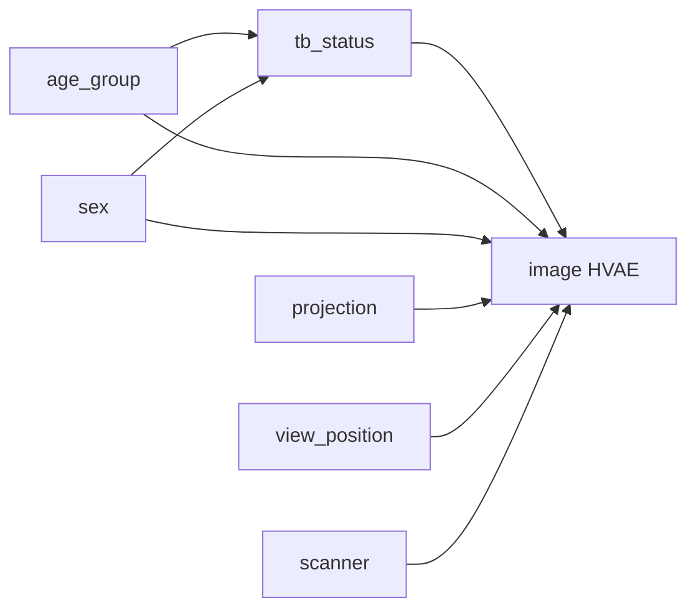

# PadChest v2 age/sex controlled-intervention ablation

**Date:** 2026-10-14  
**Dataset:** PadChest v2  
**Model:** counterfactual HVAE, checkpoint step `80200`  
**Evaluation type:** controlled intervention ablation; no feature-removed model was retrained

## Executive summary

This study measures how strongly the PadChest v2 counterfactual generator responds to
`age_group` and `sex` interventions while preserving each study's factual image
residual and holding TB status and acquisition variables fixed. Five benchmark studies
were evaluated, producing 25 age interventions and 10 sex interventions.

The generator responds more strongly to age than to sex in image space. Mean absolute
pixel change was `0.02129` for the age orbit and `0.00977` for the sex orbit in the
model's normalized `[-1, 1]` intensity space. The joint reference intervention had
mean change `0.02735`; the mean age/sex interaction residual was `0.00503`.

The SCM reached 100% target satisfaction across all 40 requested age, sex, and joint
interventions. The frozen image-parent predictor agreed
with only 20% of requested age targets and 50% of requested sex targets in this small
audit. Therefore, exact metadata intervention does not establish that the decoded
radiograph visibly expresses a clinically valid age or sex change.

## Checkpoint provenance

| Component | Checkpoint |
|---|---:|
| Counterfactual HVAE evaluated | step `80200` |
| SCM | step `198495` |
| Image-parent predictor | step `26065` |
| Base PadChest v2 image model | step `380950` |
| Input resolution | `128 x 128`, grayscale |
| Counterfactual particles | `1` |
| Random seed | `7` |
| Benchmark studies | `5` |

The evaluator is [`scripts/evaluate_padchest_age_sex_ablation.py`](../scripts/evaluate_padchest_age_sex_ablation.py). Machine-readable output is in [`metrics.json`](artifacts/padchest_age_sex_ablation/metrics.json).

## Causal intervention protocol

The evaluated v2 graph keeps age and sex as parents of TB status. Projection,
view position, scanner, and TB status are held at each study's factual values.



For each study, the evaluator abducts the factual latent residual once per
intervention orbit and applies:

- `do(age_group)` for all five categories: `0-4`, `5-17`, `18-39`, `40-64`, `65+`;
- `do(sex)` for `non-M/unknown` and `M`;
- joint reference `do(age_group=18-39, sex=non-M/unknown)`.

The requested factor is changed while all other parent variables remain factual.
The image panels and heatmaps therefore show paired model outputs rather than
independent unconditional samples.

## Quantitative results

Bootstrap confidence intervals use 4,000 resamples of the five study-level values.
Pixel MAE and interaction MAE are in normalized intensity units.

| Orbit/effect | Mean | 95% bootstrap CI |
|---|---:|---:|
| Age-group interventions, pixel MAE | 0.02129 | [0.01606, 0.02618] |
| Sex interventions, pixel MAE | 0.00977 | [0.00393, 0.01579] |
| Joint age/sex reference, pixel MAE | 0.02735 | [0.01740, 0.03731] |
| Age/sex interaction residual MAE | 0.00503 | [0.00251, 0.00755] |
| Factual-value negative controls, pixel MAE | 0.00142 | [0.00000, 0.00353] |

The age orbit produces approximately `2.18x` the mean pixel change of the sex
orbit. The interaction residual is approximately `23.6%` of the age-orbit mean
effect, so the joint response is not perfectly additive.

### Predictor and SCM consistency

| Check | Result |
|---|---:|
| SCM intervention target satisfaction | 40/40 (`100%`) |
| Predictor agreement with requested age group | 5/25 (`20%`) |
| Predictor agreement with requested sex | 5/10 (`50%`) |
| Studies evaluated | 5 |

The predictor agreement numbers are deliberately reported separately from SCM
target satisfaction. The SCM can emit the requested one-hot target exactly even
when the decoded image is not classified by the frozen predictor as that target.

### Per-study effects

| Study | Mean age MAE | Mean sex MAE | Joint MAE | Interaction MAE |
|---|---:|---:|---:|---:|
| `tb_sequela_pa` | 0.02324 | 0.01287 | 0.02607 | 0.00736 |
| `normal_pa` | 0.01791 | 0.01053 | 0.02054 | 0.00148 |
| `male_pa` | 0.01986 | 0.01275 | 0.04216 | 0.00833 |
| `male_lateral` | 0.02318 | 0.00804 | 0.03807 | 0.00638 |
| `male_ap` | 0.02227 | 0.00465 | 0.00993 | 0.00159 |

The male AP study has the smallest joint effect, while the male PA and male lateral
studies show larger joint changes. This variation indicates that the response is
conditioned by the factual image and acquisition geometry rather than being a
uniform demographic edit.

## Qualitative image results

Each panel contains the factual image followed by the five age interventions and
the two sex interventions.

### Intervention panels


The panels show recognizable radiographs with mostly subtle demographic changes.
The largest visible differences are generally diffuse intensity or anatomy-scale
changes rather than a consistently identifiable age- or sex-specific feature.

## Difference heatmaps

The maps show absolute pixel differences between each factual image and its
counterfactual output. They are image-space diagnostics, not saliency maps and not
clinical explanations. Each study uses a robust, study-specific display ceiling.


### Aggregate maps


The aggregate age map is brighter and spatially broader than the aggregate sex map,
matching the quantitative MAE comparison. The interaction map is weaker than the
main factor maps, but nonzero, indicating that joint conditioning is not exactly
the sum of independent age and sex effects.

## Interpretation

1. **Age is a stronger conditioning signal than sex.** The age orbit changes the
   decoded image more than the sex orbit, but the effect is still modest at 128 x
   128 resolution.
2. **The generator satisfies metadata interventions mechanically.** All requested
   age, sex, and joint targets were emitted exactly by the SCM path.
3. **Image-level factor realization is weak.** Predictor agreement is low for age
   and moderate for sex. This is evidence against interpreting one-hot SCM target
   satisfaction as proof of clinical demographic realism.
4. **Most changes are not obviously localized clinical edits.** Heatmaps show
   diffuse image-space changes and study-dependent responses. They do not establish
   that the model learned valid age-related anatomy or sex-related anatomy.
5. **The interaction is measurable but limited.** The joint age/sex residual is
   smaller than the primary age effect, though it is consistently above the
   near-zero negative-control scale.

## Limitations

- The audit contains five studies and is not a population-level estimate.
- The benchmark selection is inherited from the existing counterfactual report,
  not a newly sampled patient-level test split.
- The study is an intervention sensitivity analysis; it does not retrain models
  with age or sex removed.
- Pixel MAE and heatmaps measure image change, not clinical correctness.
- The predictor is an internal model trained on the same project representation;
  independent age/sex classifiers and radiologist review are still needed.
- PadChest's age and sex metadata can be missing, noisy, or confounded with
  acquisition and clinical setting.

## Reproduction

From `causal-genx/`:

```bash
PYTHONPATH=src \
/Users/mghifary/Work/Installer/miniconda3/envs/med-jax/bin/python \
scripts/evaluate_padchest_age_sex_ablation.py
```

The script writes all figures and metrics to
`journal/artifacts/padchest_age_sex_ablation/`.
