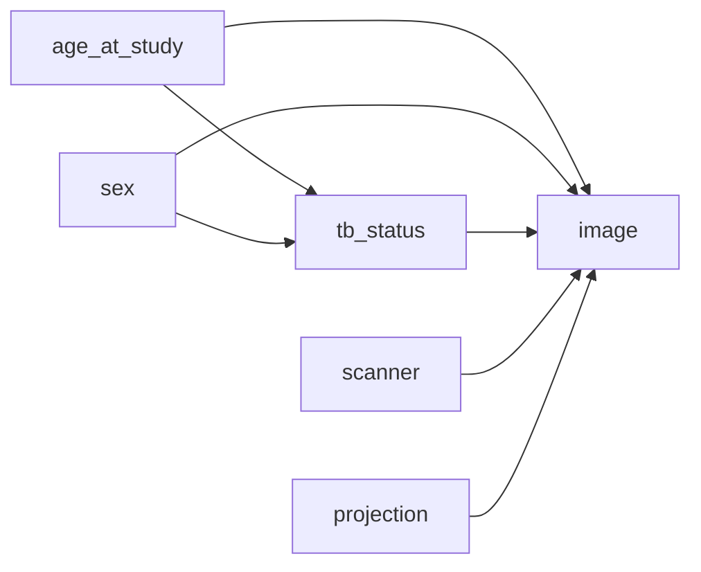

# PadChest v3 simplified counterfactual model: training and configuration plan

**Status:** GPU execution configs and v3 data path prepared; training not started
**Date:** 2026-10-16
**Last updated:** 2026-10-29
**Purpose:** Train a new, compact PadChest counterfactual image-generation pipeline for TB-related downstream evaluation.

## 1. Summary

This plan reduces the PadChest v2 image-conditioning schema from six variables and
21 channels to five variables and 9 channels. It uses continuous age,
sex, TB status, scanner manufacturer, and a normalized projection category. TB
status remains explicit because the downstream use is TB-related and requires
controlled TB-positive/TB-negative image generation.

The model is a new schema version (`v3`). The existing v2 SCM, predictor, base
HVAE, and counterfactual checkpoints must not be reused as compatible artifacts:
their metadata encoding and image context differ. Train a fresh SCM, image-parent
predictor, base HVAE, and counterfactual fine-tuned HVAE, all against one fixed
patient-level split and one v3 schema fingerprint.

### Proposed v3 context

| Variable | Encoding | Channels | Source / derivation | Role |
|---|---|---:|---|---|
| `age_at_study` | Continuous age in years, normalized from `[0, 110]` to `[-1, 1]` | 1 | Difference between `StudyDate_DICOM` year and `PatientBirth` year | Demographic; parent of TB in the assumed graph; image condition |
| `sex` | `F`, `M` | 2 | `PatientSex_DICOM` | Demographic; parent of TB in the assumed graph; image condition |
| `tb_status` | negative, positive | 1 | `Labels`, with `tb_or_sequelae` | Clinical outcome and intervention target |
| `scanner` | Imaging Dynamics, Philips | 2 | `Manufacturer_DICOM` | Acquisition domain; image condition |
| `projection` | PA, AP-family, lateral | 3 | `Projection` | Acquisition geometry; image condition |
| **Total** |  | **9** |  |  |

The `<18`, `18-64`, and `65+` ranges remain evaluation strata only. They are not
encoded as model variables and do not add context channels.

Projection mapping is `PA → PA`, `AP` and `AP_horizontal → AP-family`, and
`L → lateral`. Exclude `COSTAL`, `EXCLUDE`, `UNK`, and missing/unrecognized
projection values from the primary cohort. The source metadata has sufficient
support for the three common categories; the small nonstandard groups should not
be represented as if they had equally reliable image mechanisms.

V3 maps `F` and `M` separately and excludes `O`, missing, or unrecognized sex
values from the primary cohort. Record actual exclusion counts from the final
staging audit rather than relying on preliminary CSV counts.

## 2. Causal assumptions and scope



The edges from age and sex to TB encode the observed conditional relationship
used by the SCM. PadChest is observational: these edges do not establish that
changing a person's age or sex causes TB. Scanner and projection affect
the recorded image domain and geometry; they are not modeled as causes of TB.

The plan distinguishes two types of age/sex intervention during evaluation:

1. **Total SCM effect:** intervene on age in years or sex and let the SCM update
   downstream TB according to its learned mechanism.
2. **Controlled image effect:** intervene on age in years or sex while explicitly fixing
   TB to its factual value. This isolates the image model's direct response from
   changes mediated through TB.

TB interventions must hold age, sex, scanner, and projection fixed. Scanner
and projection interventions must hold TB and the other non-target factors fixed.
All counterfactual interpretations remain limited to observed support.

## 3. Data preparation and cohort audit

### Metadata derivation

- Derive age in years from the study date and birth year. Encode the scalar using
  the fixed `[0, 110] → [-1, 1]` mapping; do not discretize it for model input.
- Do not use the current fallback that assigns age 45 when birth year is
  missing or invalid. For v3, count invalid age records and exclude them from the
  primary causal cohort unless a documented, valid source can recover age.
- Map sex only from explicit `F` or `M`. Exclude `O`, missing, and unsupported
  values from the primary cohort and write their counts to the audit manifest.
- Derive TB with the selected `tb_or_sequelae` label policy. Keep the label rule
  fixed in all stages and all evaluation reports.
- Accept only the two configured scanner values. Fail the audit on unrecognized
  scanner values instead of silently assigning the majority manufacturer.
- Normalize projection to PA, AP-family, or lateral using the table above.
  Record excluded `COSTAL`, `EXCLUDE`, `UNK`, and missing rows.

### Split and support audit

- Group records by `PatientID` before splitting so multiple studies from one
  patient cannot cross train, validation, and test boundaries.
- Create one deterministic split manifest with seed `7` and reuse it for SCM,
  predictor, HVAE, counterfactual training, and final evaluation.
- Store schema version, categories, derivation code version, source CSV hash,
  image manifest hash, split seed, patient counts, and record-level exclusion
  reasons with the run artifacts.
- Report counts and TB-positive rates by the evaluation strata `<18`, `18-64`,
  and `65+`, sex, scanner, and projection, plus selected intersections such as
  age stratum × TB and scanner × projection. Recompute every count after applying
  the full combined validity policy.
- Existing v2 support estimates imply approximately 7,186 pediatric records
  across the former two pediatric bins, with only about 24 TB-positive cases.
  Continuous age preserves the observed ages but does not add pediatric TB
  support. Mark pediatric TB counterfactuals exploratory and report uncertainty.

### Image preprocessing

- Use the existing PadChest image source and local staging workflow.
- Convert 16-bit PNGs to 8-bit by scaling before resizing, preserving the
  preprocessing contract used by the v2 evaluator.
- Resize to grayscale `128 × 128` and normalize pixel intensities to `[-1, 1]`.
- Keep preprocessing identical across all four model stages and the test audit.

## 4. V3 implementation and GPU configuration

The PadChest provider retains its legacy v1/v2 encoders, while other typed
schemas use the shared `MetadataEncoder`. Per-variable metadata rules in the
config define derivation and strict source mappings; v3 uses a year-difference
rule, schema-declared linear normalization, exact sex/scanner mappings,
projection aliases, and label membership. Invalid metadata is recorded before
stage-manifest validation, so staging and each training split use one cohort.
Dataset fingerprints include the full schema and metadata-rule contract. SCM
selection depends on the schema, and inference walks declared variables to
encode categories and normalize continuous values instead of switching on
PadChest context dimensions. SCM, predictor, and image-model checkpoints record
the complete variable/category/edge contract; counterfactual restore rejects a
schema or metadata-rule mismatch before loading parameters.

The reusable metadata-rule operations are `column`, `year_difference`,
`category_map`, and `contains_any`. A variable's `normalization` can declare a
source and target interval, for example `linear(0,110)->(-1,1)`. Unknown fields,
categories, or binary values are rejected and captured as row exclusion reasons.

The GPU-ready configs are:

- `configs/padchest_scm_v3_gpu.yaml`
- `configs/padchest_predictor_v3_gpu.yaml`
- `configs/padchest_image_model_v3_gpu.yaml`
- `configs/padchest_counterfactual_v3_gpu.yaml`

Every config declares the same ordered schema and edges, schema version 3, and
`model.context_dim: 9`. The age variable is continuous and normalized by the
schema transform `linear(0,110)->(-1,1)`. The shared context order is age, sex, TB, scanner,
projection. V3 excludes invalid/missing age, non-F/M sex, unrecognized scanner,
and projections outside PA/AP/AP_horizontal/L; AP and AP_horizontal are merged.

The configs target one GPU (`gpu_id: "0"`, one local/global device and process,
`execution_mode: single_device`). SCM uses fp32 as required by the current SCM
training scope. Predictor, HVAE, and counterfactual training use bf16 to reduce
memory; change those configs to fp32 if the selected GPU/runtime does not support
bf16 reliably. The v3 local image stage is separate from v2 at
`/mnt/data/dataset/padchest/input-stage/v3-images`.

Artifact namespace:

- Local: `checkpoints/padchest/<stage>_padchest_v3_gpu/`
- Remote: `gs://external-cxr-dataset/padchest/checkpoints_v3/padchest/<stage>_padchest_v3_gpu/`

The counterfactual config points to the upstream `checkpoints/` roots; the loader
resolves the latest complete Orbax checkpoint beneath each root after those
stages finish. Select and record the actual steps before launch. Set
`workflow.elbo_constraint` using the measured v3 base-HVAE validation ELBO; the
checked-in `1.0` is a placeholder and must be replaced before counterfactual
training. The metadata CSV remains a VM-local configured path, so mount/copy it
to `/mnt/data/dataset/padchest/metadata/` before staging.

## 5. Training sequence and initial settings

Treat these settings as starting points copied from the successful v2 run family.
Select the best checkpoint using held-out diagnostics; do not assume the final
epoch is best.

| Stage | Initial settings | Artifact selection |
|---|---|---|
| SCM | Single GPU, fp32, seed 7, widths `[64, 64]`, batch 64, LR `1e-4`, weight decay `0.1`, 100 epochs, checkpoint each epoch | Lowest validation likelihood/loss subject to calibrated marginals and subgroup support |
| Predictor | Single GPU, bf16, batch 32, LR `1e-4`, weight decay `0.1`, 100 epochs, checkpoint each epoch | Best validation loss with age MAE/calibration and per-variable sex, TB, scanner, and projection metrics |
| Base HVAE | Single GPU, bf16, `128 × 128`, batch 32, conditional prior, LR `5e-4`, weight decay `0.01`, up to 100 epochs, checkpoint every 5 epochs | Best validation ELBO/NLL that also produces acceptable image panels and subgroup metrics |
| Counterfactual HVAE | v3 base HVAE, SCM, and predictor; single GPU, bf16, batch 32, one particle, `alpha=0.1`, `lambda_init=0`, `lr_lagrange=0.01`, damping 100, 100 epochs, checkpoint/evaluate every 5 epochs | Best checkpoint satisfying validation ELBO constraint while improving target agreement without harming reconstruction |

For the first counterfactual run, set the ELBO constraint from the measured v3
base-HVAE validation ELBO, not the v2 value `1.9730`. The v3 context and filtered
cohort change the validation distribution, so the v2 constraint is not
automatically transferable.

### Run order

1. On the GPU VM, verify config/GPU discovery with `--dry-run`.
2. Audit data derivation, patient-level splits, source availability, and category
   support. Inspect and execute bounded image staging before long training runs.
3. Train the v3 SCM and select/validate its best checkpoint.
4. Train the v3 predictor and inspect category metrics.
5. Train the v3 base HVAE and inspect reconstructions and conditional prior
   samples across supported ages, sex, TB status, scanner, and projection.
6. Measure the base HVAE validation ELBO and set the v3 counterfactual constraint.
7. Fine-tune the counterfactual HVAE using the completed v3 artifacts.
8. Run fixed patient-disjoint evaluation and qualitative panels.

### GPU VM runbook

Run from `causal-genx/` after installing the repository's CUDA-enabled JAX
environment and mounting the metadata CSV at its configured local path:

```bash
PYTHONPATH=src python scripts/run.py train-scm \
  --config configs/padchest_scm_v3_gpu.yaml --dry-run
PYTHONPATH=src python scripts/run.py train-predictor \
  --config configs/padchest_predictor_v3_gpu.yaml --dry-run
PYTHONPATH=src python scripts/run.py train-image-model \
  --config configs/padchest_image_model_v3_gpu.yaml --dry-run
PYTHONPATH=src python scripts/run.py finetune-counterfactual \
  --config configs/padchest_counterfactual_v3_gpu.yaml --dry-run
PYTHONPATH=src python scripts/stage_padchest_inputs.py \
  --config configs/padchest_predictor_v3_gpu.yaml
PYTHONPATH=src python scripts/stage_padchest_inputs.py \
  --config configs/padchest_predictor_v3_gpu.yaml --execute
PYTHONPATH=src python scripts/run.py train-scm \
  --config configs/padchest_scm_v3_gpu.yaml
PYTHONPATH=src python scripts/run.py train-predictor \
  --config configs/padchest_predictor_v3_gpu.yaml
PYTHONPATH=src python scripts/run.py train-image-model \
  --config configs/padchest_image_model_v3_gpu.yaml
# First set workflow.elbo_constraint from the measured v3 base-HVAE validation ELBO.
PYTHONPATH=src python scripts/run.py finetune-counterfactual \
  --config configs/padchest_counterfactual_v3_gpu.yaml
```

The VM identity needs read access to the configured image/metadata sources and
write access to the `checkpoints_v3` bucket prefix. A GPU VM does not imply GCS
permissions: the prior compute service account received a 403, so verify
`gcloud auth list` and read-only `gcloud storage ls` on the exact prefixes before
staging. Use authorized VM ADC or an approved user credential; never place keys
in YAML. The stage plan is bounded by configured item/byte limits; inspect its
estimated size and adjust if the complete valid cohort exceeds them.

## 6. Evaluation and acceptance criteria

### SCM

- Compare the generated age distribution with the held-out age distribution;
  report continuous calibration and summary plots, plus subgroup results by the
  three age strata.
- Check `P(tb_status | age_at_study, sex)` across observed age support. Report
  calibration and uncertainty both overall and by age strata; avoid claims for
  regions with very few positive observations.
- Keep SCM age samples within the observed training range. Evaluate intervention
  targets at empirical age quantiles and report the corresponding ages in years.
- Confirm all sampled categorical values are valid, no non-finite values occur,
  and interventions preserve non-descendants according to the graph.

### Predictor

- Report age MAE in years and calibration. Report confusion matrices, accuracy,
  macro-F1, per-class recall, and calibration for categorical variables; report
  TB sensitivity/specificity and AUROC.
- Evaluate by age strata, sex, scanner, and projection to expose shortcut reliance
  and weakly supported classes.
- Treat low performance in the `<18` TB-positive subset as a support limitation,
  not a reason to claim or tune toward unsupported realism.

### Image and counterfactual model

- Report ELBO, NLL, KL, reconstruction MAE/PSNR, and image-diversity measures on
  the fixed test split.
- For each target intervention, report SCM target satisfaction, independent
  predictor target agreement, non-target stability, and pixel change separately.
- For TB interventions, measure intended direction with an independent TB
  classifier and verify that age, sex, scanner, and projection predictions remain
  stable where the intervention semantics require them to.
- For age and sex, report both total and TB-held-fixed effects as defined above.
  For age, state the target ages in years and keep them within observed support.
- Generate paired image panels and absolute difference heatmaps with consistent
  scales. Captions must say heatmaps show pixel changes, not saliency or clinical
  explanations.
- Require blinded radiologist review of TB plausibility, anatomy preservation,
  acquisition consistency, and artifacts before describing counterfactuals as
  clinically valid.

### Release gate

Promote a v3 checkpoint only when the schema and checkpoint contracts match,
patient splits are disjoint, all required subgroups have documented support,
losses are finite, artifacts are restorable, and the evaluation report clearly
separates computational target satisfaction from clinical validity. If the
predictor or counterfactual image realization fails a target metric, record the
failure and revise training before generating augmentation data for the TB task.

## 7. Main limitations and risks

- `<18` contains far fewer images and TB-positive labels than adult groups; its
  counterfactuals will have high uncertainty even with continuous age input.
- PadChest age is derived from year-level metadata, so continuous encoding does
  not imply exact age-of-study measurement. Smooth age responses between sparse
  observations may be model assumptions rather than learned clinical changes.
- The scanner categories represent only two manufacturers from this dataset and
  do not guarantee generalization to other institutions or devices.
- Projection categories have been normalized for support and simplicity. The
  AP-family merge can hide differences between ordinary AP and horizontal-beam
  AP; report this as a design choice and revisit it if held-out image review
  shows inconsistent acquisition styles.
- Age and sex relationships with TB are observational and may reflect confounding,
  selection, or prevalence rather than direct causes.
- At 128 resolution, subtle anatomy and small lesions may not be preserved.
- A classifier agreeing with requested metadata is not proof that a generated
  radiograph is diagnostically valid.

## 8. Reproducibility record

For every stage, save the resolved config, source revision, seed, schema
fingerprint, data manifest and hashes, exclusion audit, train/validation
curves, selected checkpoint step, validation metrics, and environment/runtime
summary. Keep v3 journal artifacts under a v3-specific directory and document
all image examples with their parent conditions and intervention settings.
