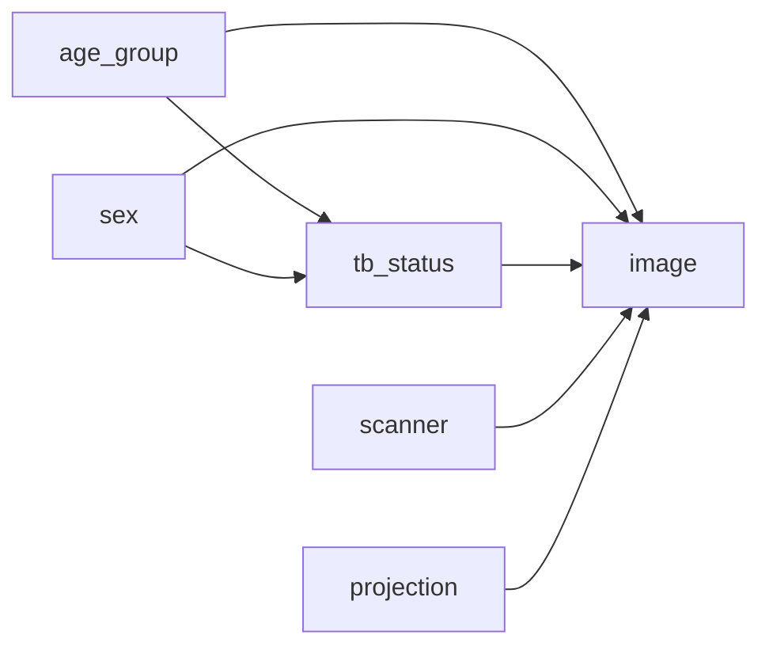

# PadChest v3 simplified counterfactual model: training and configuration plan

**Status:** Proposed training plan  
**Date:** 2026-10-16  
**Purpose:** Train a new, compact PadChest counterfactual image-generation pipeline for TB-related downstream evaluation.

## 1. Summary

This plan reduces the PadChest v2 image-conditioning schema from six variables and
21 channels to five variables and 11 channels. It uses three age groups,
sex, TB status, scanner manufacturer, and a normalized projection category. TB
status remains explicit because the downstream use is TB-related and requires
controlled TB-positive/TB-negative image generation.

The model is a new schema version (`v3`). The existing v2 SCM, predictor, base
HVAE, and counterfactual checkpoints must not be reused as compatible artifacts:
their metadata encoding and image context differ. Train a fresh SCM, image-parent
predictor, base HVAE, and counterfactual fine-tuned HVAE, all against one fixed
patient-level split and one v3 schema fingerprint.

### Proposed v3 context

| Variable | Encoding | Channels | Source / derivation | Role |
|---|---|---:|---|---|
| `age_group` | `<18`, `18-64`, `65+` | 3 | Age from `StudyDate_DICOM` and `PatientBirth` | Demographic; parent of TB in the assumed graph; image condition |
| `sex` | `F`, `M` | 2 | `PatientSex_DICOM` | Demographic; parent of TB in the assumed graph; image condition |
| `tb_status` | negative, positive | 1 | `Labels`, with `tb_or_sequelae` | Clinical outcome and intervention target |
| `scanner` | Imaging Dynamics, Philips | 2 | `Manufacturer_DICOM` | Acquisition domain; image condition |
| `projection` | PA, AP-family, lateral | 3 | `Projection` | Acquisition geometry; image condition |
| **Total** |  | **11** |  |  |

Projection mapping is `PA → PA`, `AP` and `AP_horizontal → AP-family`, and
`L → lateral`. Exclude `COSTAL`, `EXCLUDE`, `UNK`, and missing/unrecognized
projection values from the primary cohort. The source metadata has sufficient
support for the three common categories; the small nonstandard groups should not
be represented as if they had equally reliable image mechanisms.

The v2 metadata maps every non-`M` sex value to one class. V3 should map `F` and
`M` separately and exclude `O`, missing, or unrecognized sex values from the
primary cohort. The inspected CSV contained 18 `O` and 4 missing sex entries;
record the actual counts from the final input manifest rather than relying on
these preliminary counts.

## 2. Causal assumptions and scope



The edges from age and sex to TB encode the observed conditional relationship
used by the SCM. PadChest is observational: these edges do not establish that
changing a person's age group or sex causes TB. Scanner and projection affect
the recorded image domain and geometry; they are not modeled as causes of TB.

The plan distinguishes two types of age/sex intervention during evaluation:

1. **Total SCM effect:** intervene on age or sex and let the SCM update
   downstream TB according to its learned mechanism.
2. **Controlled image effect:** intervene on age or sex while explicitly fixing
   TB to its factual value. This isolates the image model's direct response from
   changes mediated through TB.

TB interventions must hold age group, sex, scanner, and projection fixed. Scanner
and projection interventions must hold TB and the other non-target factors fixed.
All counterfactual interpretations remain limited to observed support.

## 3. Data preparation and cohort audit

### Metadata derivation

- Derive age from study date and birth year, then map to `<18`, `18-64`, or `65+`.
- Do not use the current fallback that assigns age 45 when birth year is
  missing or invalid. For v3, count invalid age records and exclude them from the
  primary causal cohort unless a documented, valid source can recover age.
- Map sex only from explicit `F` or `M`. Exclude `O`, missing, and unsupported
  values from the primary cohort and write their counts to the audit manifest.
- Derive TB with the selected `tb_or_sequelae` label policy. Keep the label rule
  fixed in all stages and all evaluation reports.
- Accept only the two configured scanner values. Fail the audit on unrecognized
  scanner values instead of silently assigning the majority manufacturer.
- Normalize projection to PA, AP-family, or lateral using the table above.
  Record excluded `COSTAL`, `EXCLUDE`, `UNK`, and missing rows.

### Split and support audit

- Group records by `PatientID` before splitting so multiple studies from one
  patient cannot cross train, validation, and test boundaries.
- Create one deterministic split manifest with seed `7` and reuse it for SCM,
  predictor, HVAE, counterfactual training, and final evaluation.
- Store schema version, categories, derivation code version, source CSV hash,
  image manifest hash, split seed, patient counts, and record-level exclusion
  reasons with the run artifacts.
- Report counts and TB-positive rates by age group, sex, scanner, and projection,
  plus selected intersections such as age × TB and scanner × projection. Recompute
  every count after applying the full combined validity policy.
- Existing v2 support estimates imply approximately 7,186 pediatric records
  across the former two pediatric bins, with only about 24 TB-positive cases.
  Pooling into `<18` improves the age-group sample count but does not make
  pediatric TB counterfactuals statistically well supported. Mark those outputs
  exploratory and report uncertainty.

### Image preprocessing

- Use the existing PadChest image source and local staging workflow.
- Convert 16-bit PNGs to 8-bit by scaling before resizing, preserving the
  preprocessing contract used by the v2 evaluator.
- Resize to grayscale `128 × 128` and normalize pixel intensities to `[-1, 1]`.
- Keep preprocessing identical across all four model stages and the test audit.

## 4. Required v3 implementation and configuration work

The current code has explicit v1/v2 schema selection in the PadChest provider,
settings, context adaptation, and counterfactual restore path. A config-only
change is insufficient. Add a v3 schema and derivation path and thread its version
through provider construction, SCM and predictor metrics, image context creation,
counterfactual training, checkpoint metadata validation, inference, and evaluation.

Create a v3 family of fully resolved configs:

- `configs/padchest_scm_v3_tpu_v6e1.yaml`
- `configs/padchest_predictor_v3_tpu_v6e1.yaml`
- `configs/padchest_image_model_v3_tpu_v6e1.yaml`
- `configs/padchest_counterfactual_v3_tpu_v6e1.yaml`

Every config must declare the same ordered five-variable schema and edges,
`causal_schema.version: "3"`, and `model.context_dim: 11`. Preserve typed category
names and source mapping in the configs. Make the v3 cohort and exclusion policy
explicit rather than relying on silent defaults.

Use separate artifact paths, for example:

- Local: `checkpoints/padchest/<stage>_padchest_v3_tpu_v6e1/`
- Remote: `gs://external-cxr-dataset/padchest/checkpoints_v3/padchest/<stage>_padchest_v3_tpu_v6e1/`

Use complete, exact step checkpoints in downstream configs. Validate all
checkpoint schema versions, ordered variable names, category definitions, and
context dimensions before training or restoring. Never point a v3 stage at a v2
checkpoint.

## 5. Training sequence and initial settings

Treat these settings as starting points copied from the successful v2 run family.
Select the best checkpoint using held-out diagnostics; do not assume the final
epoch is best.

| Stage | Initial settings | Artifact selection |
|---|---|---|
| SCM | TPU, fp32, seed 7, widths `[64, 64]`, batch 64, learning rate `1e-4`, weight decay `0.1`, 100 epochs, checkpoint each epoch | Lowest validation likelihood/loss subject to calibrated marginals and subgroup support |
| Predictor | TPU, bf16, batch 64, learning rate `1e-4`, weight decay `0.1`, up to 100 epochs, checkpoint each epoch | Best validation loss with per-variable age, sex, TB, scanner, and projection metrics |
| Base HVAE | TPU, bf16, `128 × 128`, batch 32, conditional prior, learning rate `5e-4`, weight decay `0.01`, up to 100 epochs, checkpoint every 5 epochs | Best validation ELBO/NLL that also produces acceptable image panels and subgroup metrics |
| Counterfactual HVAE | Initialize from the v3 base HVAE, SCM, and predictor; TPU, bf16, batch 32, one particle, `alpha=0.1`, `lambda_init=0`, `lr_lagrange=0.01`, damping 100, 100 epochs, checkpoint/evaluate every 5 epochs | Best checkpoint satisfying the validation ELBO constraint while improving target agreement without harming reconstruction |

For the first counterfactual run, set the ELBO constraint from the measured v3
base-HVAE validation ELBO, not the v2 value `1.9730`. The v3 context and filtered
cohort change the validation distribution, so the v2 constraint is not
automatically transferable.

### Run order

1. Validate all four configs and their shared schema with `--dry-run`.
2. Audit data derivation, patient-level splits, source availability, staged
   images, and category support before accelerator training.
3. Train the v3 SCM and select/validate its best checkpoint.
4. Train the v3 predictor and inspect category-level confusion matrices and
   calibration. Fix metadata or class imbalance issues before proceeding.
5. Train the v3 base HVAE and inspect reconstructions and conditional prior
   samples by age group, sex, TB status, scanner, and projection.
6. Measure the base HVAE validation ELBO and configure the v3 counterfactual
   constraint from that result.
7. Fine-tune the counterfactual HVAE using exact SCM and predictor checkpoints.
8. Run the fixed patient-disjoint evaluation, generate qualitative panels and
   difference maps, and write training outcomes to a separate dated report.

Example config validation and training commands from `causal-genx/`:

```bash
PYTHONPATH=src python scripts/run.py train-scm \
  --config configs/padchest_scm_v3_tpu_v6e1.yaml --dry-run
PYTHONPATH=src python scripts/run.py train-scm \
  --config configs/padchest_scm_v3_tpu_v6e1.yaml

PYTHONPATH=src python scripts/run.py train-predictor \
  --config configs/padchest_predictor_v3_tpu_v6e1.yaml
PYTHONPATH=src python scripts/run.py train-image-model \
  --config configs/padchest_image_model_v3_tpu_v6e1.yaml
PYTHONPATH=src python scripts/run.py finetune-counterfactual \
  --config configs/padchest_counterfactual_v3_tpu_v6e1.yaml
```

Run each command in the configured TPU environment after staging the matching
image manifest. The commands are illustrative runbook entries; each config must
contain completed checkpoint paths before dependent stages are launched.

## 6. Evaluation and acceptance criteria

### SCM

- Verify generated category frequencies against the held-out distribution with
  marginal and conditional plots/tables.
- Check `P(tb_status | age_group, sex)` by observed support, calibration, and
  uncertainty. Avoid claims for cells with very few positive observations.
- Confirm all sampled categorical values are valid, no non-finite values occur,
  and interventions preserve non-descendants according to the graph.

### Predictor

- Report confusion matrices, accuracy, macro-F1, per-class recall, and calibration
  for all categorical variables; report TB sensitivity/specificity and AUROC.
- Evaluate by age, sex, scanner, and projection strata to expose shortcut reliance
  and weakly supported classes.
- Treat low performance in the `<18` TB-positive subset as a support limitation,
  not a reason to claim or tune toward unsupported realism.

### Image and counterfactual model

- Report ELBO, NLL, KL, reconstruction MAE/PSNR, and image-diversity measures on
  the fixed test split.
- For each target intervention, report SCM target satisfaction, independent
  predictor target agreement, non-target stability, and pixel change separately.
- For TB interventions, measure intended direction with an independent TB
  classifier and verify that age, sex, scanner, and projection predictions remain
  stable where the intervention semantics require them to.
- For age and sex, report both total and TB-held-fixed effects as defined above.
- Generate paired image panels and absolute difference heatmaps with consistent
  scales. Captions must say heatmaps show pixel changes, not saliency or clinical
  explanations.
- Require blinded radiologist review of TB plausibility, anatomy preservation,
  acquisition consistency, and artifacts before describing counterfactuals as
  clinically valid.

### Release gate

Promote a v3 checkpoint only when the schema and checkpoint contracts match,
patient splits are disjoint, all required subgroups have documented support,
losses are finite, artifacts are restorable, and the evaluation report clearly
separates computational target satisfaction from clinical validity. If the
predictor or counterfactual image realization fails a target metric, record the
failure and revise training before generating augmentation data for the TB task.

## 7. Main limitations and risks

- `<18` contains far fewer images and TB-positive labels than adult groups; its
  counterfactuals will have high uncertainty even after pooling pediatric ages.
- The scanner categories represent only two manufacturers from this dataset and
  do not guarantee generalization to other institutions or devices.
- Projection categories have been normalized for support and simplicity. The
  AP-family merge can hide differences between ordinary AP and horizontal-beam
  AP; report this as a design choice and revisit it if held-out image review
  shows inconsistent acquisition styles.
- Age and sex relationships with TB are observational and may reflect confounding,
  selection, or prevalence rather than direct causes.
- At 128 resolution, subtle anatomy and small lesions may not be preserved.
- A classifier agreeing with requested metadata is not proof that a generated
  radiograph is diagnostically valid.

## 8. Reproducibility record

For every stage, save the resolved config, source revision, seed, schema
fingerprint, data manifest and hashes, exclusion audit, train/validation
curves, selected checkpoint step, validation metrics, and environment/runtime
summary. Keep v3 journal artifacts under a v3-specific directory and document
all image examples with their parent conditions and intervention settings.
